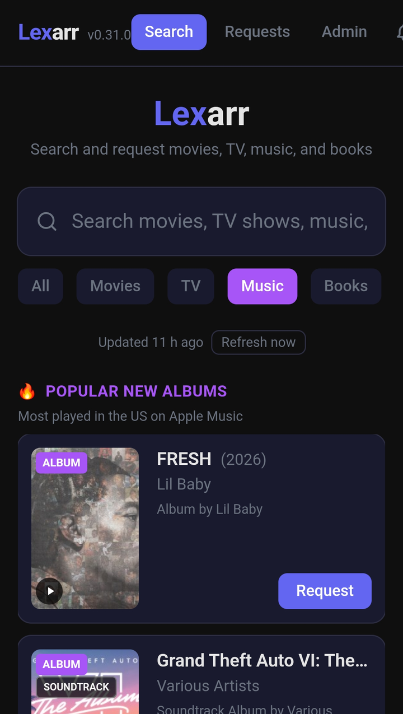
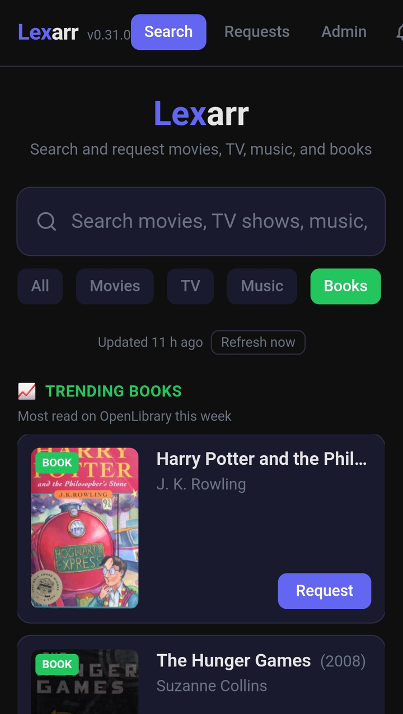
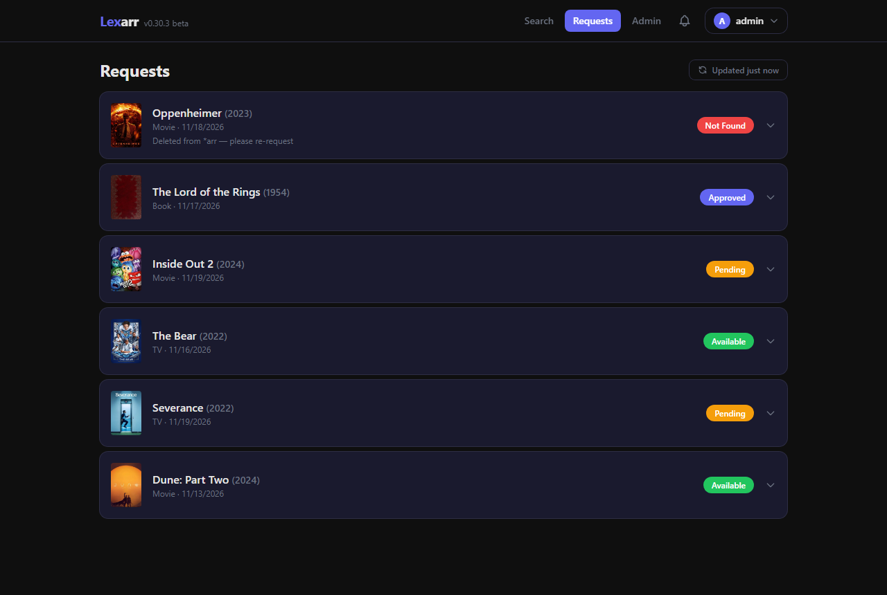
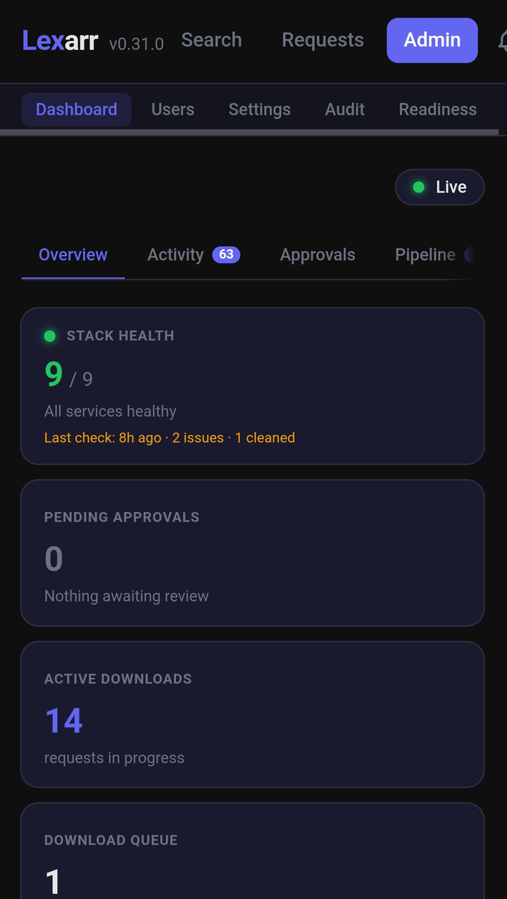
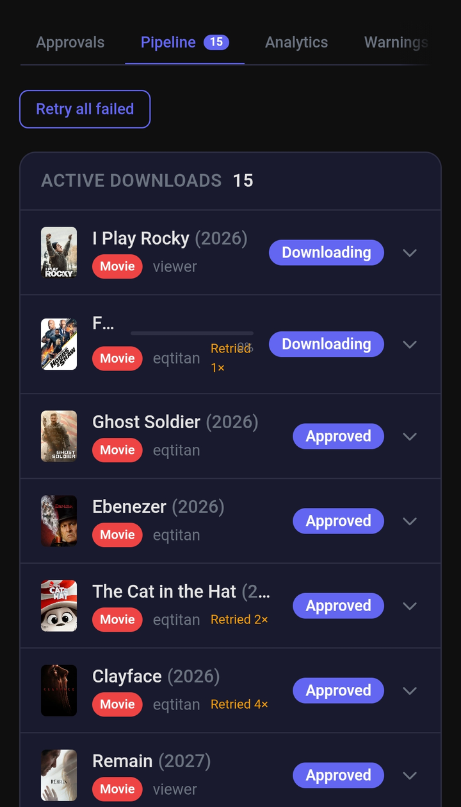
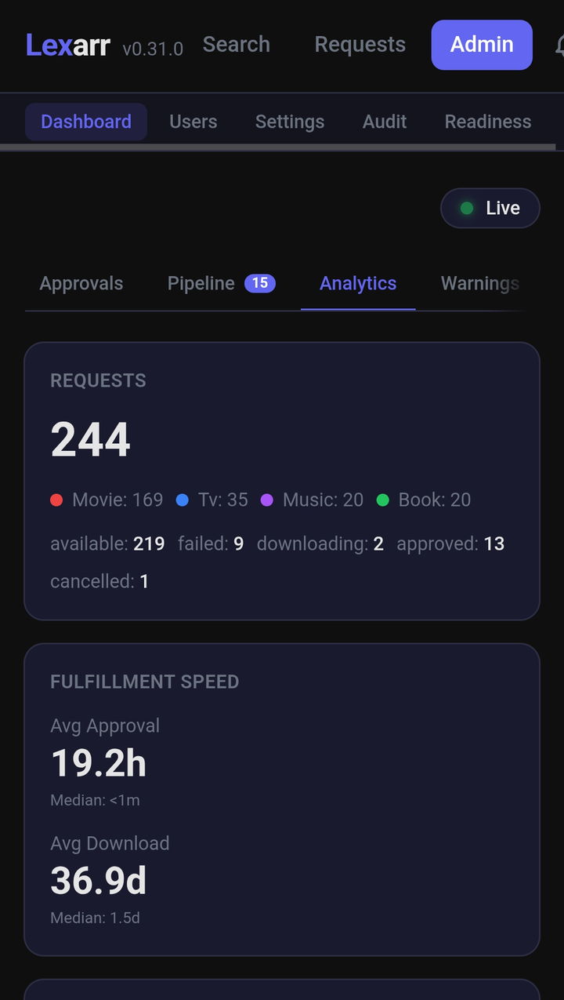

# Lexarr

> **One Docker container. One search bar. Every request type your \*arr stack handles.**

 [](https://github.com/eqtitan/Lexarr/releases) [](https://github.com/eqtitan/Lexarr/actions/workflows/ci.yml) 

Lexarr is a unified media request portal that gives your entire \*arr stack a single front door. Search movies, TV, music, and books in one place — Lexarr routes each request to the right app automatically.

---

## Why Lexarr?

If you run a full \*arr stack, you already know the problem: **Overseerr and Jellyseerr only cover movies and TV.** Music requests mean going directly into Lidarr. Books have no good request UI at all unless you set one up yourself. The result is that your family or roommates need to know which tool handles what — or you handle all requests manually.

Lexarr fixes that with one portal that covers all four media types.

| | Overseerr / Jellyseerr | Ombi | **Lexarr** |
|---|---|---|---|
| Movies + TV | ✅ | ✅ | ✅ |
| Music (Lidarr) | ❌ | ✅ | ✅ |
| Books (LazyLibrarian) | ❌ | ❌ | ✅ |
| Music singles/EPs (narrow monitoring) | ❌ | ❌ | ✅ |
| Single Docker container | ✅ | ✅ | ✅ |

**Where Lexarr is currently weaker:** Smaller community, newer codebase, fewer edge cases handled than tools with years of history. Plex support exists but is secondary — Jellyfin is the primary focus. No mobile app; browser only.

---

## What It Does

Lexarr provides a single search bar that searches across all your media sources, lets users request content with one click, and routes each request to the correct *arr app automatically:

| Media Type | Search Source | Routes To |
|-----------|--------------|-----------|
| Movies | TMDB | Radarr |
| TV Shows | TMDB | Sonarr |
| Music | MusicBrainz | Lidarr |
| Books | Open Library | LazyLibrarian |

## Features

- **Unified search** across movies, TV, music, and books with type filters
- **One-click requests** routed to the correct *arr app
- **Auth** via Plex SSO, Jellyfin, or standalone accounts
- **Per-user approval** - admin can set trusted users to auto-approve, others need manual approval
- **Admin dashboard** with live download queue, pipeline tracking, analytics, and bottleneck detection
- **Deep-drill service pages** for each *arr app (library stats, queue, wanted, history, system info)
- **Pipeline events** tracking every step from request to availability
- **Docker-ready** with SQLite (zero external dependencies)

## Screenshots

<table>
<tr>
<th>Search</th>
<th>TV</th>
<th>Music</th>
</tr>
<tr>
<td></td>
<td></td>
<td></td>
</tr>
<tr>
<th>Books</th>
<th>Your requests</th>
<th>Admin overview</th>
</tr>
<tr>
<td></td>
<td></td>
<td></td>
</tr>
<tr>
<th>Approvals</th>
<th>Pipeline</th>
<th>Analytics</th>
</tr>
<tr>
<td></td>
<td></td>
<td></td>
</tr>
</table>

*Screenshots are from a v0.31.0 beta instance, captured on mobile.*

---

## Project Status

Lexarr is **pre-1.0** and runs every day in a real household with Radarr,
Sonarr, Lidarr, LazyLibrarian, Prowlarr and Jellyfin. It has shipped
60+ releases since March 2026; see the [Releases](https://github.com/eqtitan/Lexarr/releases)
page or [`CHANGELOG.md`](CHANGELOG.md) for what changed in each.

Pre-1.0 means minor versions may still change behavior or configuration.
Every such change is called out in the changelog, and database migrations
run automatically on start.

To follow development: [r/Lexarr](https://reddit.com/r/Lexarr) · [Watch this repo](https://github.com/eqtitan/Lexarr/subscription)

---

## Quick Start (Docker — ≤ 10 min)

Prereqs: Docker, an already-running *arr stack (at minimum one of
Radarr / Sonarr / Lidarr), and a free [TMDB API key](https://www.themoviedb.org/settings/api)
for movie/TV search.

### 1 · Get the code (30 s)

```bash
git clone https://github.com/eqtitan/Lexarr.git
cd Lexarr
```

### 2 · Create `.env` (4 min)

```bash
cp .env.example .env
```

Open `.env` and fill in — every variable is documented inline with
where to find it. The absolute minimum:

- `NEXTAUTH_SECRET` — `openssl rand -base64 32`
- `NEXTAUTH_URL` — `http://<your-server-ip>:5056`
- `ARR_HOST` — `http://<your-server-ip>` (no port — Lexarr appends 7878/8989/8686 itself)
- `RADARR_API_KEY` / `SONARR_API_KEY` / `LIDARR_API_KEY` — from each app's Settings → General → API Key
- `TMDB_API_KEY` — your TMDB key
- `LEXARR_WEBHOOK_SECRET` — `openssl rand -hex 16`

### 3 · Start it (2 min)

Using `docker compose` (simplest):

```bash
docker compose up -d --build
docker compose logs -f lexarr    # wait for "✓ Ready in …"
```

Or plain `docker run`:

```bash
docker build -t lexarr .
docker run -d \
  --name lexarr \
  --env-file .env \
  -p 5056:5056 \
  -v lexarr-data:/app/data \
  --cap-drop=ALL --security-opt=no-new-privileges \
  --pids-limit=256 --memory=1g \
  --restart unless-stopped \
  lexarr
```

### 4 · Verify (30 s)

```bash
curl http://<your-server-ip>:5056/api/healthz
```

Healthy response:
```json
{"ok":true,"checks":{"db":{"ok":true,...},"arrs":[...]},"reason":null,...}
```

### 5 · Sign up (1 min)

Open `http://<your-server-ip>:5056` and register. **The first user
becomes admin**, and sign-up closes after that (the Register tab
disappears). Family and friends then sign in with their Jellyfin or Plex
account, if you enabled those, or you set `REGISTRATION_OPEN=true` while
they create accounts. Admins choose per user whether requests need
approval.

### 6 · (Optional) Webhooks for instant status updates (2 min)

In each *arr (Radarr / Sonarr / Lidarr), go to Settings → Connect →
Webhook and add:

- **URL** · `http://<lexarr-host>:5056/api/webhooks/<arr>`
  (replace `<arr>` with `radarr` / `sonarr` / `lidarr`)
- **Password** · your `LEXARR_WEBHOOK_SECRET` (Username can be anything)
- **Events** · On Import, On Upgrade
- **Method** · POST

The secret travels as HTTP Basic auth, so it stays out of URLs and access
logs. The older form, `…/api/webhooks/<arr>?token=<LEXARR_WEBHOOK_SECRET>`,
still works.

Without webhooks, Lexarr polls every 60 s instead.

### Total time: ~10 minutes

If something fails, see
[`docs/upgrading.md`](docs/upgrading.md) for troubleshooting steps
and [`docs/security-checklist.md`](docs/security-checklist.md) for
the secrets/hardening pass.

## Staying up to date

Lexarr tells you when a new release is out, three ways:

- **In the app.** Admins see an **Update** badge in the top bar (and an
  "Update available" line in the account menu on phones) when a newer
  release exists. It links to that release's notes. Lexarr asks GitHub for
  the latest release once a day and sends nothing about your install. Set
  `LEXARR_UPDATE_CHECK=false` to turn it off, e.g. on an air-gapped host.
- **On GitHub.** Click **Watch → Custom → Releases** on the repository to get
  an email or notification for each release.
- **In a feed reader.** Subscribe to
  `https://github.com/eqtitan/Lexarr/releases.atom`.

To apply an update, follow [`docs/upgrading.md`](docs/upgrading.md): back up
the database, pull the new version, `docker compose up -d --build`. Patch
releases (`0.x.y`) are always safe in place; minor releases may change
configuration before 1.0, so read the release notes first. A pre-built
`ghcr.io` image, which would also let Watchtower and Unraid update it for
you, is on the [roadmap](#roadmap-to-100).

## Configuration

Copy `.env.example` to `.env` and fill in your values:

| Variable | Required | Description |
|----------|----------|-------------|
| `NEXTAUTH_SECRET` | Yes | Random string for session encryption. Generate with `openssl rand -base64 32` |
| `NEXTAUTH_URL` | Yes | URL where Lexarr is accessible (e.g. `http://192.168.1.100:5056`) |
| `AUTH_TRUST_HOST` | Yes (Docker) | Set to `true` for non-localhost deployments |
| `ARR_HOST` | Yes | IP/hostname of your *arr server (e.g. `http://192.168.1.100`) |
| `RADARR_API_KEY` | Yes | Find in Radarr > Settings > General > API Key |
| `SONARR_API_KEY` | Yes | Find in Sonarr > Settings > General > API Key |
| `LIDARR_API_KEY` | Yes | Find in Lidarr > Settings > General > API Key |
| `TMDB_API_KEY` | Yes | Free key from [themoviedb.org/settings/api](https://www.themoviedb.org/settings/api) |
| `JELLYFIN_URL` | No | Enables Jellyfin login (e.g. `http://192.168.1.100:8096`) |
| `PLEX_CLIENT_ID` | No | Defaults to `lexarr`. Enables Plex SSO |
| `PROWLARR_API_KEY` | No | For future Prowlarr integration |
| `LAZYLIBRARIAN_API_KEY` | No | For book request routing |
| `LEXARR_UPDATE_CHECK` | No | Set to `false` to turn off the admin "update available" check (see [Staying up to date](#staying-up-to-date)) |

Every other variable (proxies, extra public URLs, rate limits, notifications)
is optional and documented inline in [`.env.example`](.env.example).

## Development

```bash
# Install dependencies
npm install

# Set up the database
cp .env.example .env
# Edit .env with your values
npx prisma migrate deploy

# Start dev server
npm run dev
```

Open `http://localhost:3000`.

### Tests

```bash
npm test                          # unit + integration (vitest)
npx playwright install chromium   # once
npm run build && npm run e2e      # end-to-end smoke (Playwright)
```

The end-to-end suite runs the production build against a throwaway SQLite
DB and a stub TMDB/Radarr/Sonarr/Lidarr server (`e2e/stub-server.mjs`), so
it needs no real services. It uses ports 5057, 7878, 8686, 8989 and 9100.

Tests that touch the database should use a real one rather than mocking
`@/lib/db`: import `src/__tests__/helpers/test-db.ts` first and call
`useTestDb()`. Each test file gets its own copy of a template DB migrated
once per run, emptied before every test, so real constraints, indexes and
transactions are exercised (see `src/__tests__/db/` for examples).

## Deployment model

Lexarr runs as a **single instance**. It stores data in SQLite and keeps
some state in process memory (search/library caches, *arr circuit
breakers, the in-flight status check, Plex sign-in sessions), so don't run
two containers against the same database. One container comfortably
serves a household; the DB-backed rate limiter and the guarded status
writes mean a restart loses nothing important.

## Tech Stack

- **Framework**: Next.js 16 (App Router, Turbopack)
- **Database**: SQLite via Prisma
- **Auth**: NextAuth.js v5 (Plex SSO, Jellyfin, credentials)
- **UI**: Tailwind CSS v4, dark mode
- **Deployment**: Docker (Node 22 Alpine, runs as a non-root user)

## Architecture

```
src/
  app/                    # Next.js pages and API routes
    admin/dashboard/      # Admin dashboard + deep-drill service pages
    api/                  # REST API (search, request, auth, status, admin)
    login/                # Plex/Jellyfin/credentials login
  components/             # React components
    dashboard/            # Dashboard-specific components
  lib/
    arr/                  # *arr API clients (Radarr, Sonarr, Lidarr, LazyLibrarian)
    auth/                 # Auth providers (Plex, Jellyfin)
    dashboard/            # Analytics and warning computation
    search/               # Search clients (TMDB, MusicBrainz, Open Library)
  types/                  # TypeScript type definitions
prisma/
  schema.prisma           # Database schema
```

## Roadmap to 1.0.0

1.0.0 ships when these are done:

- [ ] A release runs 7 days in a row with no P0 incident
      *(P0 = data loss, container crash loop, or auth bypass)*
- [ ] The Quick Start is confirmed by someone who has never seen the repo
- [ ] A published image on `ghcr.io`, so you can `docker pull` instead of
      building from source
- [ ] Health-check failures can be sent to Lexarr's own notification channels

Already in place: the 10-minute Quick Start, every variable documented in
`.env.example`, a complete `docker-compose.yml` with a health check,
[upgrade notes](docs/upgrading.md), a [security checklist](docs/security-checklist.md),
`/api/healthz` and `/api/livez`, automatic migrations tested from an empty
0.1.0 database in CI, and a private vulnerability disclosure policy
([`SECURITY.md`](SECURITY.md)).

## Versioning

Lexarr follows [Semantic Versioning](https://semver.org). See
[`CHANGELOG.md`](CHANGELOG.md) for release history and
[`.changelog-rules.md`](.changelog-rules.md) for the commit prefix
conventions and how a release is cut.

A release is a normal PR (`chore: release vX.Y.Z`) that bumps the version
and dates the CHANGELOG's `[Unreleased]` block; once merged it ships with
`deploy.ps1` (rehearse first — see `CLAUDE.md` → Deployment).

## Contributing

- **Bug reports:** [GitHub Issues](https://github.com/eqtitan/Lexarr/issues). Include your Lexarr version (shown in the nav), your \*arr versions, the relevant Docker log lines, and steps to reproduce.
- **Feature requests:** GitHub Issues with the `enhancement` label, or post in [r/Lexarr](https://reddit.com/r/Lexarr).
- **Security problems:** please don't open a public issue; see [`SECURITY.md`](SECURITY.md).
- **Pull requests:** welcome. Read [`CONTRIBUTING.md`](CONTRIBUTING.md) first.

## License

[MIT](LICENSE)
