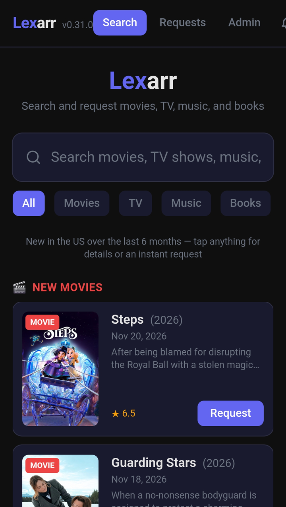
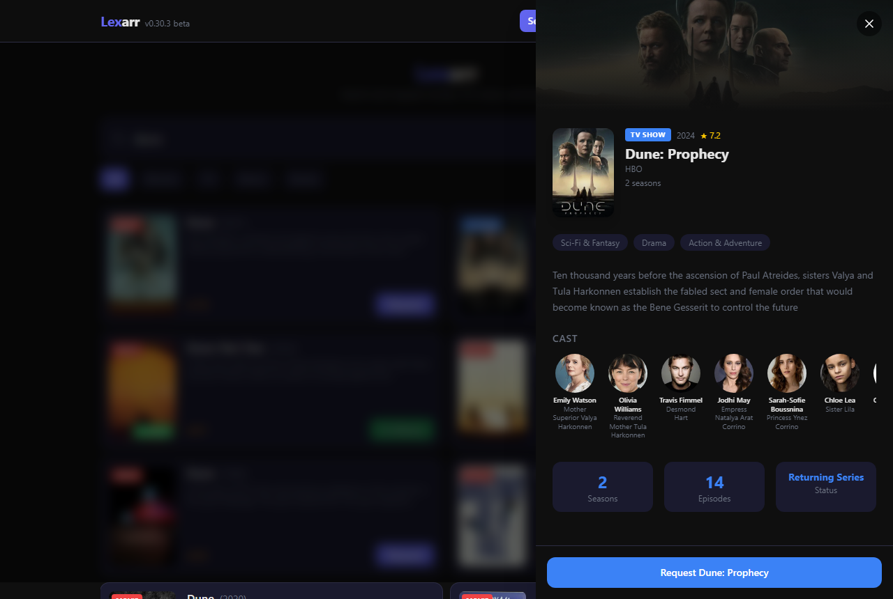
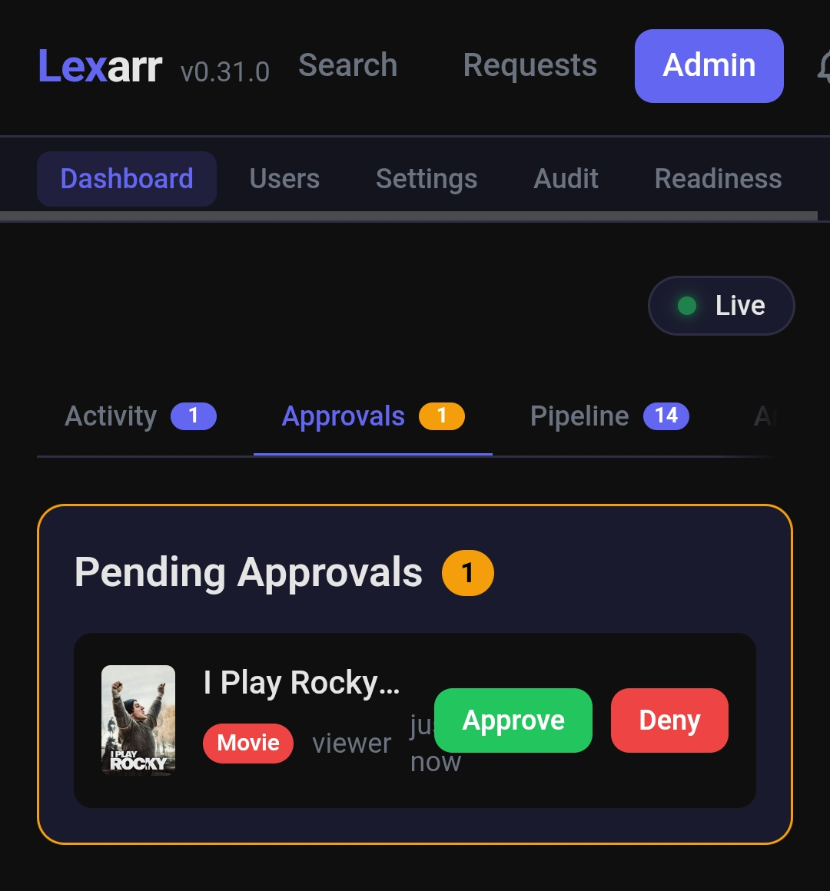

# Lexarr

> **One Docker container. One search bar. Every request type your \*arr stack handles.**

  

Lexarr is a unified media request portal that gives your entire \*arr stack a single front door. Search movies, TV, music, and books in one place — Lexarr routes each request to the right app automatically.

---

## Why Lexarr?

If you run a full \*arr stack, you already know the problem: **Overseerr and Jellyseerr only cover movies and TV.** Music requests mean going directly into Lidarr. Books have no good request UI at all unless you set one up yourself. The result is that your family or roommates need to know which tool handles what — or you handle all requests manually.

Lexarr fixes that with one portal that covers all four media types.

| | Overseerr / Jellyseerr | Ombi | **Lexarr** |
|---|---|---|---|
| Movies + TV | ✅ | ✅ | ✅ |
| Music (Lidarr) | ❌ | ✅ | ✅ |
| Books (LazyLibrarian) | ❌ | ❌ | ✅ |
| Music singles/EPs (narrow monitoring) | ❌ | ❌ | ✅ |
| Single Docker container | ✅ | ✅ | ✅ |
| Active development | Maintained | Slowing | ✅ |

**Where Lexarr is currently weaker:** Smaller community, newer codebase, fewer edge cases handled than tools with years of history. Plex support exists but is secondary — Jellyfin is the primary focus. No mobile app; browser only.

---

## What It Does

Lexarr provides a single search bar that searches across all your media sources, lets users request content with one click, and routes each request to the correct *arr app automatically:

| Media Type | Search Source | Routes To |
|-----------|--------------|-----------|
| Movies | TMDB | Radarr |
| TV Shows | TMDB | Sonarr |
| Music | MusicBrainz | Lidarr |
| Books | Open Library | LazyLibrarian |

## Features

- **Unified search** across movies, TV, music, and books with type filters
- **One-click requests** routed to the correct *arr app
- **Auth** via Plex SSO, Jellyfin, or standalone accounts
- **Per-user approval** - admin can set trusted users to auto-approve, others need manual approval
- **Admin dashboard** with live download queue, pipeline tracking, analytics, and bottleneck detection
- **Deep-drill service pages** for each *arr app (library stats, queue, wanted, history, system info)
- **Pipeline events** tracking every step from request to availability
- **Docker-ready** with SQLite (zero external dependencies)

## Screenshots

| Search | Request flow | Admin dashboard |
|--------|-------------|-----------------|
|  |  |  |

*Screenshots from v0.17.1 beta running on Unraid.*

---

## Project Status

**Lexarr is in private beta.** The code is not yet public — it will be opened at the 1.0.0 release milestone, which requires 7 consecutive days of stable production running with no critical incidents.

Current version: **v0.17.1**. Active known issue: music singles/EP routing is being refined.

To follow development: [r/Lexarr](https://reddit.com/r/Lexarr) · [Watch this repo](https://github.com/eqtitan/Lexarr/subscription)

To request beta access: DM u/eqtitan on Reddit with your GitHub username.

---

## Quick Start (Docker — ≤ 10 min)

Prereqs: Docker, an already-running *arr stack (at minimum one of
Radarr / Sonarr / Lidarr), and a free [TMDB API key](https://www.themoviedb.org/settings/api)
for movie/TV search.

### 1 · Get the code (30 s)

```bash
git clone https://github.com/eqtitan/Lexarr.git
cd Lexarr
```

### 2 · Create `.env` (4 min)

```bash
cp .env.example .env
```

Open `.env` and fill in — every variable is documented inline with
where to find it. The absolute minimum:

- `NEXTAUTH_SECRET` — `openssl rand -base64 32`
- `NEXTAUTH_URL` — `http://<your-server-ip>:5056`
- `ARR_HOST` — `http://<your-server-ip>` (no port — Lexarr appends 7878/8989/8686 itself)
- `RADARR_API_KEY` / `SONARR_API_KEY` / `LIDARR_API_KEY` — from each app's Settings → General → API Key
- `TMDB_API_KEY` — your TMDB key
- `LEXARR_WEBHOOK_SECRET` — `openssl rand -hex 16`

### 3 · Start it (2 min)

Using `docker compose` (simplest):

```bash
docker compose up -d --build
docker compose logs -f lexarr    # wait for "✓ Ready in …"
```

Or plain `docker run`:

```bash
docker build -t lexarr .
docker run -d \
  --name lexarr \
  --env-file .env \
  -p 5056:5056 \
  -v lexarr-data:/app/data \
  --restart unless-stopped \
  lexarr
```

### 4 · Verify (30 s)

```bash
curl http://<your-server-ip>:5056/api/healthz
```

Healthy response:
```json
{"ok":true,"checks":{"db":{"ok":true,...},"arrs":[...]},"reason":null,...}
```

### 5 · Sign up (1 min)

Open `http://<your-server-ip>:5056` and register. **The first user
becomes admin.** If you're bringing in family/friends later, they'll
need you to approve their signup from the admin dashboard unless you
set `REGISTRATION_OPEN=true`.

### 6 · (Optional) Webhooks for instant status updates (2 min)

In each *arr (Radarr / Sonarr / Lidarr), go to Settings → Connect →
Webhook and add:

- **URL** · `http://<lexarr-host>:5056/api/webhooks/<arr>?token=<LEXARR_WEBHOOK_SECRET>`
  (replace `<arr>` with `radarr` / `sonarr` / `lidarr`)
- **Events** · On Import, On Upgrade
- **Method** · POST

Without webhooks, Lexarr polls every 60 s instead.

### Total time: ~10 minutes

If something fails, see
[`docs/upgrading.md`](docs/upgrading.md) for troubleshooting steps
and [`docs/security-checklist.md`](docs/security-checklist.md) for
the secrets/hardening pass.

## Configuration

Copy `.env.example` to `.env` and fill in your values:

| Variable | Required | Description |
|----------|----------|-------------|
| `NEXTAUTH_SECRET` | Yes | Random string for session encryption. Generate with `openssl rand -base64 32` |
| `NEXTAUTH_URL` | Yes | URL where Lexarr is accessible (e.g. `http://192.168.1.100:5056`) |
| `AUTH_TRUST_HOST` | Yes (Docker) | Set to `true` for non-localhost deployments |
| `ARR_HOST` | Yes | IP/hostname of your *arr server (e.g. `http://192.168.1.100`) |
| `RADARR_API_KEY` | Yes | Find in Radarr > Settings > General > API Key |
| `SONARR_API_KEY` | Yes | Find in Sonarr > Settings > General > API Key |
| `LIDARR_API_KEY` | Yes | Find in Lidarr > Settings > General > API Key |
| `TMDB_API_KEY` | Yes | Free key from [themoviedb.org/settings/api](https://www.themoviedb.org/settings/api) |
| `JELLYFIN_URL` | No | Enables Jellyfin login (e.g. `http://192.168.1.100:8096`) |
| `PLEX_CLIENT_ID` | No | Defaults to `lexarr`. Enables Plex SSO |
| `PROWLARR_API_KEY` | No | For future Prowlarr integration |
| `LAZYLIBRARIAN_API_KEY` | No | For book request routing |

## Development

```bash
# Install dependencies
npm install

# Set up the database
cp .env.example .env
# Edit .env with your values
npx prisma db push

# Start dev server
npm run dev
```

Open `http://localhost:3000`.

## Tech Stack

- **Framework**: Next.js 16 (App Router, Turbopack)
- **Database**: SQLite via Prisma
- **Auth**: NextAuth.js v5 (Plex SSO, Jellyfin, credentials)
- **UI**: Tailwind CSS v4, dark mode
- **Deployment**: Docker (Node 20 Alpine)

## Architecture

```
src/
  app/                    # Next.js pages and API routes
    admin/dashboard/      # Admin dashboard + deep-drill service pages
    api/                  # REST API (search, request, auth, status, admin)
    login/                # Plex/Jellyfin/credentials login
  components/             # React components
    dashboard/            # Dashboard-specific components
  lib/
    arr/                  # *arr API clients (Radarr, Sonarr, Lidarr, LazyLibrarian)
    auth/                 # Auth providers (Plex, Jellyfin)
    dashboard/            # Analytics and warning computation
    search/               # Search clients (TMDB, MusicBrainz, Open Library)
  types/                  # TypeScript type definitions
prisma/
  schema.prisma           # Database schema
```

## Roadmap to 1.0.0

Lexarr is currently **pre-1.0** (`0.10.0` as of 2026-04-17). Pre-1.0
releases may contain backwards-incompatible changes between minor versions.
Each milestone has explicit **exit criteria** — a version ships when every
box is checked, not when a feature list is complete.

### Shipped

#### `0.6.0` — UX polish *(2026-04-16)*
- [x] Every button has loading / success / error state
- [x] Every API error → user-visible, actionable message (no silent failures)
- [x] Mobile layout audited (dashboard works on phone)
- [x] Empty states for every list (no results, no queue, no warnings)
- [x] Toasts consistent (color, duration, position, dismissal)

#### `0.7.0` — Reliability *(2026-04-16; 2 items completed in 0.9.0)*
- [x] No `catch {}` silently swallowing errors without logging
- [x] Retry logic reviewed — nothing loops forever
- [x] Circuit breakers on every *arr call *(shipped in 0.9.0 — timeouts
      + typed errors landed in 0.7.0 via `arrFetch`; per-call breakers
      in 0.9.0)*
- [x] All POST routes either idempotent or documented non-idempotent
      *(shipped in 0.9.0 — see
      [`docs/POST-idempotency.md`](docs/POST-idempotency.md))*

#### `0.7.1` — Stuck-download detection *(2026-04-17, patch)*
- Surfaces *arr errors to `Request.lastError` for user-visible diagnostics
- Book stall detection (was missing from 0.7.0)
- arrId-drift handling — detects when an *arr ID has been reused for a
  different title and marks the request failed with a clear reason

#### `0.8.0` — Version visibility *(2026-04-17)*
- [x] Inline version + channel label in nav (`Lexarr v0.8.0 beta`) —
      derived from `package.json` at build time, channel (`alpha` / `beta` /
      `rc` / `stable`) derived from the SemVer string
- [x] CI workflow — typecheck, lint, test on every push and PR

#### `0.9.0` — Observability *(2026-04-17)*
- [x] "Diagnose" action on down-service pills (log tail + last error,
      read-only, no container control)
- [x] Request lifecycle visible end-to-end: submitted → approved → sent →
      downloading → completed/failed, each step timestamped
- [x] Audit log readable without scrolling for common actions
- [x] Stack-health tile deep-links to the healthcheck report body
- [x] Per-*arr circuit breakers *(rolled from 0.7.0)*
- [x] POST route idempotency audit *(rolled from 0.7.0 — see
      [`docs/POST-idempotency.md`](docs/POST-idempotency.md))*

#### `0.10.0` — Release readiness *(2026-04-17)*
- [x] README explains setup in ≤ 10 min for someone with an existing *arr
      stack
- [x] `.env.example` documents every variable with inline comments
- [x] `docker-compose.yml` is a complete working example *(with
      Docker-native healthcheck probing `/api/healthz`)*
- [x] Migration path docs (upgrading from 0.x to 0.y) — see
      [`docs/upgrading.md`](docs/upgrading.md)
- [x] Security checklist (secrets rotation, headers, CORS) — see
      [`docs/security-checklist.md`](docs/security-checklist.md); four
      baseline HTTP security headers now applied via `next.config.ts`
- [x] `SECURITY.md` with private disclosure policy *(GitHub gates the
      Security Advisories feature on this)*
- [x] `/api/healthz` endpoint validating DB reachability + at least one
      *arr key — not just "Next.js is alive"
- [x] `npm audit` clean + Docker base-image CVE check documented —
      see [`docs/security-audit.md`](docs/security-audit.md)
- [x] Migration smoke test — upgrade from an empty 0.1.0 DB passes
      `prisma migrate deploy` without manual intervention *(wired into
      CI as a required step)*

*Also shipped (not on original exit criteria):*
- Music search ranking fix — singles/EPs surface instead of being buried
  by partial-match albums; Live / Remix / Acoustic badges
- Hotfix 0.9.1 — search cache no longer poisoned by upstream outages

### Planned

#### `1.0.0` — Public launch
- [ ] 0.10.0 ran in prod for 7 consecutive days with no P0 incident
      *(P0 = data loss, container crashloop, or auth bypass)*
- [ ] CI green on every push for those 7 days
- [ ] README validated by at least one external tester who hasn't seen
      the repo before — the only way to check "clear enough for a
      stranger" without going public first
- [ ] GitHub Release notes written manually (1.0.0 matters)
- [ ] Repo flipped to public
- [ ] Branch protection enabled on master *(rulesets, not classic —
      free tier on public repos; blocks force-push + deletion, admin
      bypass allowed)*
- [ ] `SECURITY.md` + `LICENSE` + `README.md` all visible on the
      public-facing repo
- [ ] At least one Lexarr image pushed to `ghcr.io` with the `1.0.0`
      tag so others can `docker pull`

## Versioning

Lexarr follows [Semantic Versioning](https://semver.org). See
[`CHANGELOG.md`](CHANGELOG.md) for release history and
[`.changelog-rules.md`](.changelog-rules.md) for the commit prefix
conventions that drive automated CHANGELOG generation.

Release a new version with:

```bash
npm run release -- patch    # bug fix:      0.10.0 → 0.10.1
npm run release -- minor    # new feature:  0.10.0 → 0.11.0
npm run release -- major    # breaking:     0.10.0 → 1.0.0 (only when 1.0 criteria met)
npm run release -- --dry    # preview without writing
```

## Contributing

The repo is currently private while in beta. Once public at 1.0.0:

- **Bug reports:** GitHub Issues. Include your \*arr versions, Docker logs, and steps to reproduce.
- **Feature requests:** GitHub Issues with the `enhancement` label, or post in [r/Lexarr](https://reddit.com/r/Lexarr).
- **PRs:** Welcome. The codebase is TypeScript throughout with 0 lint errors and 78 passing tests. Read `CLAUDE.md` for architecture orientation before starting.

During private beta, report bugs by opening a GitHub Issue if you have repo access, or DMing u/eqtitan on Reddit.

## License

[MIT](LICENSE)
